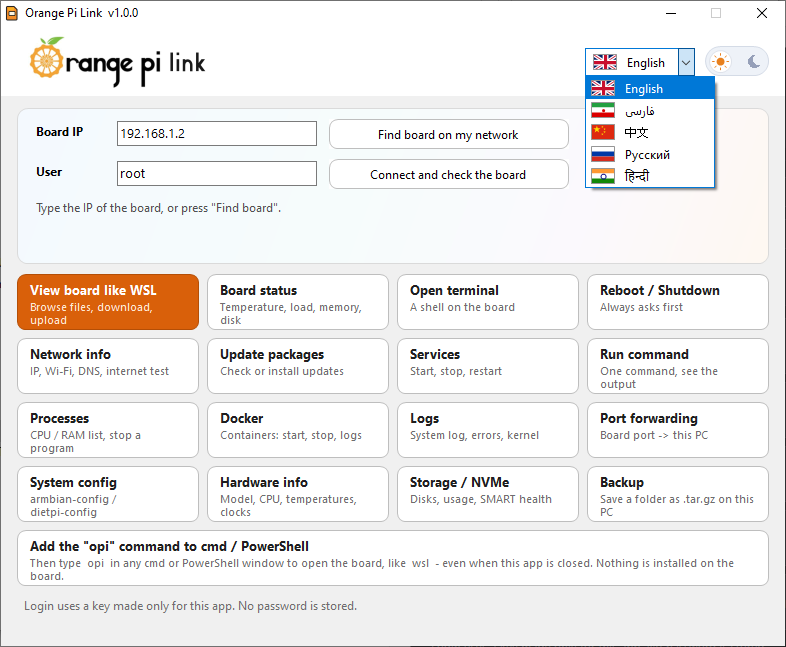
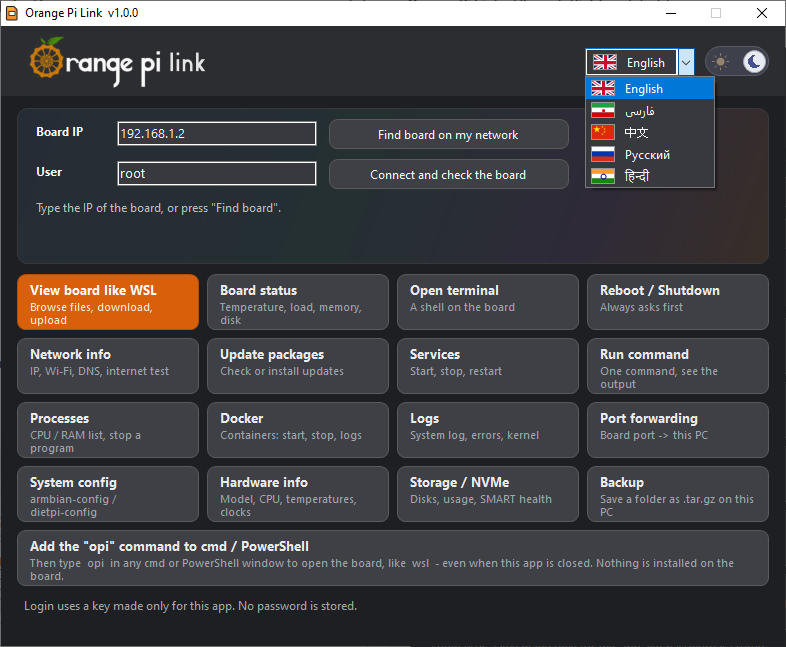
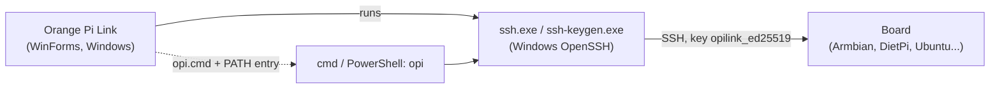

# Orange Pi Link

**Manage your Orange Pi (or any Linux SBC) from Windows with one click: browse its files like WSL, see its status, open a terminal, update it, back it up. No installation on the board.**

[](LICENSE)
[](https://github.com/OrangePiShell/Opilink/actions/workflows/ci.yml)


<p align="center">
  
  
</p>

## Features

- **View board like WSL**: browse the board's files, download (a folder is saved as one `.tar`), upload (asks before replacing), open a terminal in the current folder. It never deletes, renames or changes permissions on the board.
- **Board status**: name, system, kernel, IP, uptime, load, memory, CPU temperature, disk, refreshed every 5 seconds (can be turned off).
- **Open terminal**, **Run command** (one command, see the output), **Logs**, **Processes**, **Services**, **Docker**, **Network info**, **Hardware info**, **Storage / NVMe** (SMART if `smartctl` exists).
- **Update packages** (`apt`, `dnf` or `pacman`), **Reboot / Shutdown**, **System config** (`armbian-config` / `dietpi-config`).
- **Port forwarding**: a board port becomes `http://127.0.0.1:PORT` on this PC.
- **Backup**: save a board folder as `.tar.gz` on this PC.
- **`opi` command**: type `opi` in any cmd / PowerShell window to open the board, like `wsl`, even when the app is closed.
- **System detection**: works on Armbian, DietPi, Ubuntu, Debian and others. Tiles that do not work on the detected system are greyed out with the reason.
- **Safe by default**: everything that changes the board (power, update, services, kill, Docker stop/restart) asks first.
- Light and dark theme.
- **5 languages:** English, فارسی, 中文, Русский, हिन्दी. Pick one with the flag box in the top-right corner (the app restarts). Output that comes from the board itself (logs, file names, command results) stays as the board prints it.

## Download

> [Latest release](https://github.com/OrangePiShell/Opilink/releases/latest). Look for `OpiLink-v<version>-win-x64.zip`.

**Requirements:** Windows 10 or 11 (64-bit) with the optional feature **OpenSSH Client** (Settings → Apps → Optional features). A board running Linux with an SSH server, in the same network, with a private IPv4 address (`192.168.x.x`, `10.x.x.x`, `172.16-31.x.x`).

**Quick start**
1. Unzip the file to any folder (keep the `assets` folder next to `OpiLink.exe`).
2. Double-click `OpiLink.exe`.
3. Type the board IP and user (or press **Find board on my network**), then **Connect and check the board**. The first time, a black window asks for the board password; it is typed there only and is never seen or saved by the app.

**Verify the download**
```
certutil -hashfile OpiLink-v<version>-win-x64.zip SHA256
```
Compare the result with `SHA256SUMS.txt` from the same Release.

> Windows SmartScreen or your antivirus may warn about this app because it is not code-signed. The full source code is in this repository and the exe is built automatically by GitHub Actions from it. You can verify the file with the SHA-256 checksum, or build it yourself (see [Build from source](#build-from-source)).

## Tech stack

- C# (WinForms, .NET Framework 4, built with the `csc.exe` that ships with Windows)
- Windows OpenSSH client (`ssh.exe`, `ssh-keygen.exe`) for all communication with the board
- Plain shell commands run on the board over SSH (nothing installed there)

## How it works



The app never talks to the board directly. It starts the normal Windows `ssh` with a key made only for this app and shows the text that comes back. After connecting it runs one short read-only check (`/etc/os-release`, is `systemctl` / `docker` / `smartctl` there, which package manager) and greys out tiles that cannot work.

## Build from source

1. Install nothing: Windows already contains the compiler.
2. Clone or download the repository.
3. Double-click `start.bat`. On the first run it compiles `app\*.cs` into `OpiLink.exe` and starts it.

The exact command (also used by the CI):
```
%WINDIR%\Microsoft.NET\Framework64\v4.0.30319\csc.exe /nologo /codepage:65001 /target:winexe /out:OpiLink.exe /win32icon:assets\app.ico /win32manifest:app\app.manifest /r:System.Windows.Forms.dll /r:System.Drawing.dll app\*.cs
```
If the build fails, copy the error text from the black window and open an issue.

## Usage

- **Files**: double-click a folder to enter it, **Up** / **Home** or type a path and press Enter. **Download selected**, **Upload file here**, **Terminal here**.
- **Run command**: type one command, read the output.
- **`opi` command**: press the wide tile at the bottom once, then open a **new** cmd or PowerShell window:
  ```
  opi
  opi uname -a
  ```
  Press the tile again to change the IP or to remove the command.
- Tiles that change the board show a confirmation first.

## Where things are stored

| What | Where |
|------|-------|
| Last IP / user | `%APPDATA%\OpiLink\settings.txt` |
| Theme | `%APPDATA%\OpiLink\theme.txt` |
| Language | `%APPDATA%\OpiLink\lang.txt` |
| SSH key made for this app | `%USERPROFILE%\.ssh\opilink_ed25519` (+ `.pub`) |
| `opi` command (only if you add it) | `%LOCALAPPDATA%\OpiLink\bin\opi.cmd` and one entry in your user `PATH` |

### Data & privacy
No password is stored. No data is sent anywhere except to your board over SSH, and the app contains no telemetry or update check. To remove everything: delete the folders above, delete the key files, remove the `opi` entry with the tile, and remove the public key line (comment `opilink`) from `~/.ssh/authorized_keys` on the board.

## Project structure

```
app/            C# source (LinkForm = main window, Ssh/Remote/Cmds = talking to the board, *Form = tool windows)
lang/           translations (fa, zh, ru, hi), one text file each; keep next to OpiLink.exe
assets/         app icon and wordmark (the exe loads assets/wordmark.png at runtime)
docs/           screenshots (light, dark), v2 plan, languages plan, UI mock-up
mock/           UI mock page
.github/        CI, release workflow, issue/PR templates
start.bat       builds (first run) and starts the app
```

## FAQ / Troubleshooting

- **"ssh.exe was not found"**: turn on the Windows feature *OpenSSH Client* (Settings → Apps → Optional features).
- **Password asked again / "password may have been wrong"**: try again; the key is only installed after a correct password.
- **Host key changed after burning a new SD card**: the app asks before it forgets the old key for that IP.
- **A text is still English in my language**: it is not in `lang/<code>.txt` yet (or it comes from the board). Add it, see [CONTRIBUTING.md](CONTRIBUTING.md).
- **Persian layout**: texts read right to left, but the window layout is not mirrored.
- **Some tiles are grey**: the board's system does not have the needed tool (for example `docker`, `smartctl`); the tile says which one.
- **Logs / backup say "passwordless sudo"**: log in as `root`, or allow passwordless `sudo` for that user on the board.
- **`The .NET Framework 4 compiler was not found`** (`start.bat`): you need Windows 10/11 or the .NET Framework 4.x feature.
- **SmartScreen / antivirus warning**: see the note in [Download](#download).

## Roadmap

- [ ] Test and polish all 16 tools on more boards and distros
- [ ] Review the translations with native speakers; more languages (Spanish, ...)
- [ ] Several saved boards
- [ ] Set Wi-Fi / static IP from the app
- [ ] Optional real Explorer drive (needs WinFsp + SSHFS-Win)

## Contributing

See [CONTRIBUTING.md](CONTRIBUTING.md). Security issues: [SECURITY.md](SECURITY.md).

## Disclaimer

This software is provided "as is", without warranty of any kind. Tiles such as Reboot, Update, Services, Processes and Docker change the state of your board; use them at your own risk and keep backups.

Orange Pi Link is an independent community project. It is **not affiliated with or endorsed by Orange Pi / Shenzhen Xunlong Software Co., Ltd.** "Orange Pi" is the name of its owner. The orange-fruit logo in `assets/wordmark.png` follows their brand style; it is not covered by the MIT license and may be replaced in a future release.

## License

MIT, see [LICENSE](LICENSE).

## 💜 Support the project

If this project is useful to you, you can support its development. Thank you!

| Coin | Network | Address |
|------|---------|---------|
| TRX  | TRON    | `TFd5vJqcFw2xjSbuZbkWiowh3g2YjXj9pW` |
| USDT | TRON (TRC20) | `TFd5vJqcFw2xjSbuZbkWiowh3g2YjXj9pW` |

> Only send on the **TRON** network. Coins sent on another network (Ethereum, BSC, Bitcoin, ...) to this address are lost.

## Acknowledgements

- The Windows OpenSSH client and the .NET Framework that make this possible
- The Orange Pi, Armbian and DietPi communities
